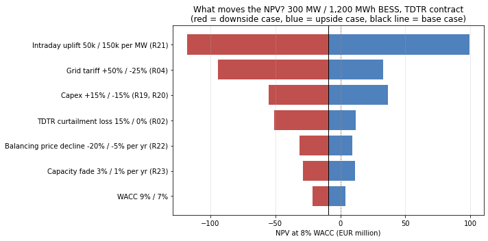

# 300 MW / 1,200 MWh BESS at Hollandse Kust Noord – Revenue and Business Case Model

Python models behind an independent concept design and business case for a
300 MW / 1,200 MWh battery energy storage system at TenneT's 380 kV
Hollandse Kust Noord landstation (Velsen, the Netherlands).

📄 **Full report and case study:** [sites.google.com/view/sagarkansara/bess-case-study](https://sites.google.com/view/sagarkansara/bess-case-study)

## What the models do

| Script | Purpose |
|---|---|
| `step1_load_prices.py` | Loads and explores 2025 Dutch day-ahead prices (daily spread, negative hours, hourly profile) |
| `step2_arbitrage.py` | Linear program that finds the optimal daily charge/discharge schedule; compares 2h and 4h batteries |
| `step3_revenue_stack.py` | Adds aFRR and FCR capacity revenue and the opportunity cost of reserving MW for balancing |
| `step4_business_case.py` | First business case: NPV, IRR, payback, firm vs TDTR grid contract |
| `step5_business_case_final.py` | Final business case with capex built from the engineered equipment, scenarios, break-even uplift and tornado chart |

## Key results (4h design, TDTR contract)

- Day-ahead arbitrage: **€131k/MW/yr** (2h: €83k/MW, matching Modo Energy's 2025 figure)
- Capex: **€271M** (€226/kWh rated)
- Bank case (intraday uplift €100k/MW): **NPV −€9M, IRR 7.3%** against an 8% hurdle
- Break-even intraday/imbalance uplift: **€104k/MW/yr**, about half the market estimate
- Largest NPV drivers: trading uplift, TenneT grid tariff, capex

## How to run

1. Install Python 3 with `pandas`, `numpy`, `scipy` and `matplotlib` (all included in Anaconda).
2. Download hourly Dutch wholesale prices from
   [Ember](https://ember-energy.org/data/european-wholesale-electricity-price-data/)
   and save the file as `Netherlands.csv` in the repository folder.
3. Run the scripts in order, e.g. `python step2_arbitrage.py`.

## Main assumptions and limitations

- Perfect foresight of day-ahead prices (an upper bound for day-ahead revenue)
- The battery is a price taker; its own trading doesn't move prices
- Intraday and imbalance revenue is not modelled; it's an assumed uplift tested by break-even analysis
- Pre-tax, real-terms model; aFRR activation energy excluded

All assumptions and sources are listed in the full report (Appendix: Key assumptions).

## Data sources

ENTSO-E Transparency Platform via Ember (prices) · Modo Energy (grid charges, aFRR prices) ·
KYOS (intraday uplift estimate) · Coloprice and Ember (capex) · ACM/TenneT (tariffs)

## Author

Sagar Kansara · [LinkedIn](https://www.linkedin.com/in/sagar-kansara/) · [Portfolio](https://sites.google.com/view/sagarkansara/home)
